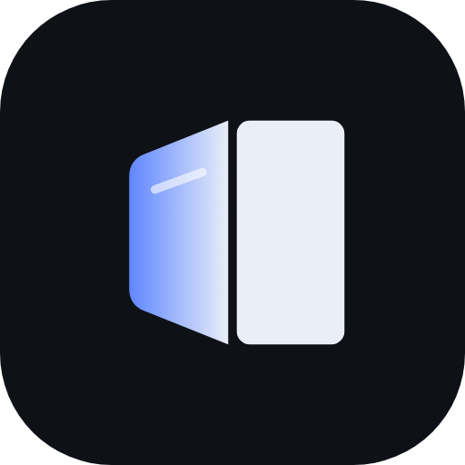

# N6 Fold Duo

An iPhone Duo-style fold animation for the **OPPO Find N6**.

As you fold or unfold the phone, the left half of the inner screen turns toward you like a page:

- **Shape**: a perspective trapezoid whose outer edge shrinks toward the middle, with rounded,
  soft-edged outer corners.
- **Blur**: strongest at the outer edge, fading to sharp at the hinge, so it meets the right half
  without a seam.
- **Live**: your real screen, captured live, not a screenshot.
- **Movement**: follows the hinge angle in real time, holds its position while you hold the phone
  still, and flattens back to normal when fully open or closed.
- **Leaves the rest alone**: it never darkens the screen, and the outer (cover) screen is left
  untouched by default.

**Status:** early and only tested on the Find N6 (CPH2765, ColorOS 16 / Android 16). Other
foldables are unlikely to work without changes.

## Requirements

- OPPO Find N6.
- A PC with [adb](https://developer.android.com/tools/releases/platform-tools), once, to turn on
  the accessibility service and to start Shizuku.
- [Shizuku](https://github.com/RikkaApps/Shizuku), for the angled left page. Without it you get
  only an even blur over the left half.

## Install

1. Get the APK from [Releases](https://github.com/chris-hemmings/n6-fold-duo/releases), or add
   `https://github.com/chris-hemmings/n6-fold-duo` to [Obtainium](https://github.com/ImranR98/Obtainium)
   to install it and get updates automatically. To install from a PC:
   ```
   adb install n6-fold-duo.apk
   ```
2. Turn on the accessibility service. Doing it with adb avoids Android's "restricted setting" block
   for sideloaded apps. **This replaces any other accessibility services you have enabled.**
   ```
   adb shell settings put secure enabled_accessibility_services com.n6.foldduo/.FoldService
   adb shell settings put secure accessibility_enabled 1
   ```
3. Install Shizuku and start it. You can use the Start button in the Shizuku app with Wireless
   debugging, or run this from a PC. Shizuku has to be started again after every reboot.
   ```
   adb shell sh /storage/emulated/0/Android/data/moe.shizuku.privileged.api/start.sh
   ```
   Then open **N6 Fold Duo** and tap **Authorize Shizuku**.
4. Fold the phone shut once and open it once, slowly, so the app learns the angles where ColorOS
   switches between the screens.

The overlay never takes touches and the app doesn't save or send screen content. The Shizuku helper
captures only the left half of the inner screen while you're folding, to draw the angled page.

## Settings

Every setting is adjustable in the app. Drag the **Preview** slider to see the effect at any angle
without folding.

**Match iPhone Duo** sets the look seen on the iPhone Duo. The left half's content isn't warped on
screen, since the panel's own tilt provides the perspective. It's heavily blurred, the blur carries on about 7% past the hinge, and the left half darkens toward
its outer edge. The default look instead angles the left page into a fixed rounded trapezoid.

**Window projection** (off unless you turn it on) is an experimental alternative. It treats the left
panel as a window onto the flat screen behind it, so the picture gets shorter toward the outer edge
as the panel tilts. **Sideways stretch** adds the sideways part of that projection, which only looks
right from exactly the assumed eye position.

| Setting | Default | What it does |
| --- | --- | --- |
| Angle the left page | on | Perspective left page (needs Shizuku) |
| Outer edge shorter by | 40% | How much the outer edge shrinks toward the middle |
| Left page width (from the middle) | 100% | Pulls the outer edge in toward the hinge |
| Corner rounding | 250 px | Outer corner radius, easing to the screen's own radius as it opens |
| Edge softness | 40 px | Feathers the page edge into the black around it; the hinge side stays crisp |
| Blur past the hinge | 0% | Carries the blur this far into the right half (% of screen width), so there's no line at the fold |
| Left page shade | 0% | Darkens the left page, most at its outer edge |
| Window projection | off | Left page as a window onto the flat screen (replaces the trapezoid) |
| Viewing distance | 35 cm | Closer makes the projection stronger |
| Sideways stretch / Eye position | 0% / 50% | Optional sideways part of the projection, and where it assumes your eye is |
| Blur | 60 px | Maximum blur, strongest at the outer edge |
| Blur only the left half | on | Used when Shizuku isn't connected |
| Hinge shadow / Glass sheen | 60% / 100% | Shading along the hinge, and a moving highlight |
| Motion smoothing | 20 ms | Lower is snappier, higher is smoother |
| Capture resolution | 40% | Lower is faster; raise it if the left page looks soft |
| Fully open / closed at | 172° / 2° | Where the effect ends |
| Also animate the outer screen | off | Blur on the cover screen |

## Troubleshooting

- **No angled page, only blur.** Check that Shizuku is running (it stops on reboot) and that the
  app's status line says `Shizuku: connected`.
- **Turn on Show angle readout.** It shows the live angle, the active screen, the learned switch
  angles and the capture rate (`capturing (NN fps)`).
- **The effect ends too early or too late.** Tap **Re-learn screen switch angles**, then fold and
  unfold once, slowly.
- **No blur at all.** Battery saver can turn off Android's window blur.
- **Logs.** Run `adb logcat -s N6DUO`; for crashes, `adb logcat -d -b crash`.

## How it works

- **Hinge angle**: the Find N6 exposes a smooth `android.sensor.hinge_angle` sensor (type 36,
  about 50 Hz, 0° closed to about 180° open) that any app can read. Readings arrive on their own
  thread, and each frame predicts the current angle from how fast the hinge is moving.
- **Displays**: logical display 0 is always the lit screen (inner when open, cover when closed), so
  one overlay on display 0 follows the active screen. The app records the hinge angles where
  ColorOS switches screens (they differ when opening and closing) and ends each screen's effect
  there.
- **Overlay**: an accessibility-service overlay (`TYPE_ACCESSIBILITY_OVERLAY`). Everything is drawn
  into one `SurfaceView`.
- **Live left page**: a Shizuku user service (`ShellService`) runs as the shell user and captures
  just the left page with the hidden `IWindowManager.captureDisplay`, leaving out the overlay's own
  surface so it never captures itself. The frame comes back as a `HardwareBuffer` with no copy.
  The app blurs it at capture resolution with `RenderEffect`, blends it from blurred to sharp
  toward the hinge, and draws it through a perspective matrix. A blurred mask then cuts the
  rounded trapezoid shape.

## Build

The build uses Ubuntu's Android tools rather than Gradle and the Google SDK:

```
sudo apt install aapt apksigner zipalign dalvik-exchange android-sdk-platform-23
sh build.sh        # writes n6-fold-duo.apk
```

- **Two Android jars**: resources link against the API 23 platform. Java compiles against the
  Android 16 framework jar from Robolectric (`android-all`, downloaded to `sdk/` on the first
  build), which includes the hidden capture APIs `ShellService` uses. App-side code uses only
  public APIs.
- **No lambdas**: `dx` can't desugar them, so `libs/api-desugared.jar` is Shizuku's `api.jar` run
  through Retrolambda (`tools/desugar-shizuku.sh`). The build fails if any lambda bytecode remains,
  and the project code uses anonymous classes instead.
- **Signing key**: `build.sh` creates `debug.keystore` on first run. Keep it, because Android won't
  install an update signed with a different key.

`probe/` is the small diagnostic app used to find the hinge sensors and display layout
(`sh probe/build.sh`).

### Releases

`.github/workflows/release.yml` builds the APK on GitHub and publishes it as a release, which is
what Obtainium follows. To release:

1. Bump `versionCode` and `versionName` in `AndroidManifest.xml` and push.
2. On the Actions tab, open **Release** and click **Run workflow**. It tags the commit
   `v<versionName>` and creates the release. Pushing a `v<versionName>` tag does the same.

Every release is signed with the same key, stored as the `KEYSTORE_B64` repository secret (the
base64 of `debug.keystore`, password `android`). Don't replace it, or existing installs can't
update.

## Credits

Inspired by [Duo Fold Live](https://github.com/joeconsorti/duo-fold-live) for the Galaxy Z Fold.
Uses the [Shizuku](https://github.com/RikkaApps/Shizuku-API) API (Apache-2.0). See
[THIRD_PARTY_NOTICES.md](THIRD_PARTY_NOTICES.md).
